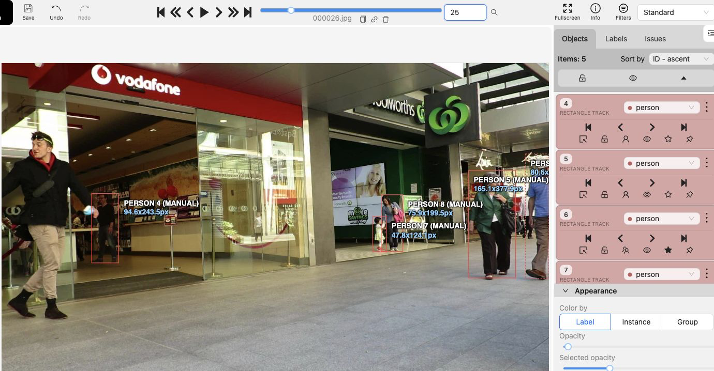
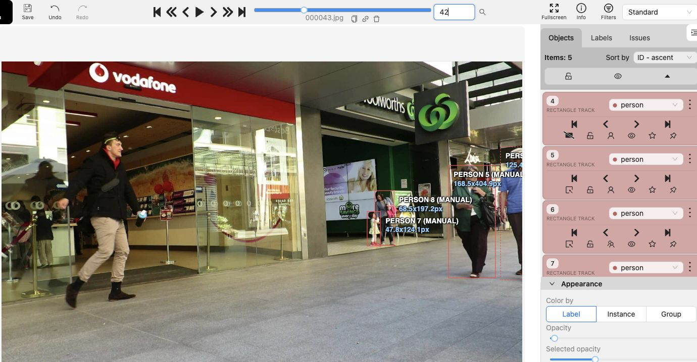
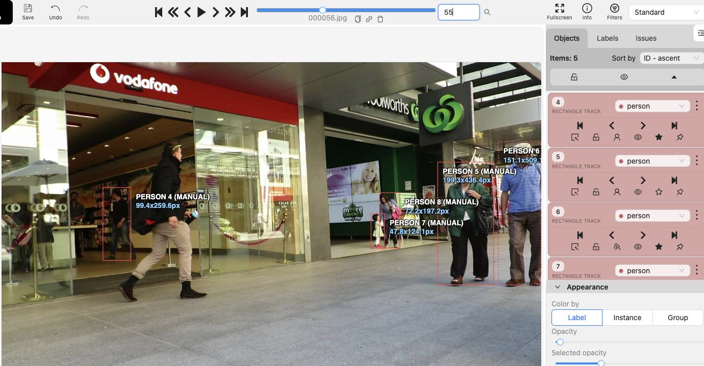
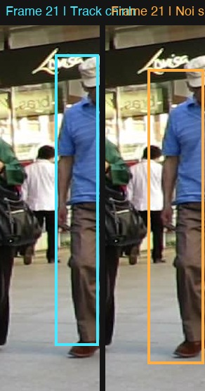

# Báo cáo cá nhân — Phùng Danh Khoa — 2A202603206

Đoạn video: MOT17-09, 150 frame (frame 1–150), nguồn MOTChallenge, giấy phép CC BY-NC-SA 3.0.

## 0. Thông tin học viên

- Họ tên: Phùng Danh Khoa
- MSSV: 2A202603206
- Mã đề (A/B/C): B
- Email: phungdanhkhoa0712@gmail.com
- Link repository: https://github.com/phungdanhkhoa/K5-L2A-PhungDanhKhoa-2A202603206-MOTTracking
- Giờ bắt đầu: Không ghi lại.
- Giờ kết thúc: Không ghi lại. Bản xuất CVAT được tạo lúc 17:39 ngày 13/11/2026 (GMT+7).

## 1. Xem trước đoạn video (CP0)

Bảng dưới đây được đối chiếu sau khi gán từ hai file xuất và các frame mẫu trên máy. Các số frame theo CVAT, bắt đầu từ 0.

| Mã | Frame xuất hiện | Frame cuối thấy được | Chuyển động quan sát được | Bị che theo bản xuất CVAT | Ghi chú |
|---|---:|---:|---|---|---|
| P1 | 0 | 149 | Từ trong cửa hàng đi ra phía lối đi | Che một phần 26–38, 45–54 và 101–110. Mất hẳn 39–44 | Áo tối, quần jeans. |
| P2 | 0 | 149 | Đi từ bên phải về phía máy quay, box lớn dần | Track không có cờ che | Áo khoác xanh lá, mang túi đen. |
| P3 | 0 | 149 | Đi từ mép phải về phía máy quay, box lớn dần | Che một phần 0–64 | Áo xanh dương, đội mũ. |
| P4 | 0 | 146 | Ở xa, gần cửa hàng bên phải | Che một phần 105–110, 135–139 và 142–146. Vắng 111–134 | Box nhỏ, dễ lẫn với P5 khi đứng sát. |
| P5 | 0 | 138 | Ở xa, gần P4 | Che một phần 89–106 và 123–138. Vắng 107–122 | P2 và P3 đi qua phía trước ở cuối đoạn. |

## 2. Keyframe và thời gian (CP1, CP4)

Số keyframe lấy từ kết quả `src/check_submission.py`.

| Mã | Số keyframe | Keyframe ở frame | Số frame có mặt | Keyframe / 100 frame | Thời gian (phút) | Chỗ khó |
|---|---|---|---|---|---|---|
| P1 | 22 | 0, 1, 11, 21, 26, 27, 29, 31, 45, 49, 51, 55, 61, 71, 81, 91, 101, 111, 121, 131, 141, 149 | 144 | 15.3 | Chưa có số đo | Đoạn khuất 39–44, cần nối lại đúng người ở frame 45. |
| P2 | 19 | 0, 1, 11, 21, 31, 41, 51, 61, 66, 71, 81, 91, 101, 111, 121, 130, 131, 141, 149 | 150 | 12.7 | Chưa có số đo | Box lớn dần khi người đi về phía máy quay. |
| P3 | 31 | 0, 1, 11, 18, 19, 20, 21, 24, 25, 30, 34, 45, 46, 52, 54, 55, 60, 61, 65, 66, 67, 68, 70, 80, 90, 100, 110, 120, 130, 140, 149 | 150 | 20.7 | Chưa có số đo | Người sát mép phải lúc đầu, sau đó box lớn dần. |
| P4 | 11 | 0, 10, 20, 30, 40, 50, 105, 110, 135, 140, 142 | 123 | 8.9 | Chưa có số đo | Box nhỏ ở xa và mất dấu ở 111–134. |
| P5 | 13 | 0, 10, 20, 30, 40, 50, 89, 92, 123, 135, 136, 137, 138 | 123 | 10.6 | Chưa có số đo | Đi sát P4, có đoạn mất dấu 107–122. |
| **Tổng** | **96** | | **690** | **13,9** | Chưa có số đo | |

Keyframe / 100 frame của cả bài = 96 ÷ 690 × 100 ≈ 13,9.

P3 có nhiều keyframe nhất (31 keyframe trong 150 frame có mặt).

Ở P1, có các keyframe gần lúc bị che và lúc hiện lại (26–31 và 45–55) để bám vị trí box qua đoạn khuất. P3 có nhiều keyframe gần nhau ở 60–70, quanh mốc tắt cờ che ở frame 65.

## 3. Đoạn bị che (CP2)

Người bị che: `P1` (MOT ID 1). Các mốc dưới đây lấy từ cờ trong bản xuất CVAT.

| Mốc | Frame |
|---|---:|
| Bắt đầu bị che một phần (bật `occluded`) | 26 |
| Mất hẳn (bật `outside`) | 39 |
| Hiện lại (tắt `outside`) | 45 |
| Thấy rõ trở lại (tắt `occluded`) | 55 |

- Thời gian khuất hẳn: 6 frame (39–44) = 0,20 giây ở 30 fps.
- Quyết định: Giữ cùng ID, theo bản xuất MOT.
- Lý do: Đoạn khuất kéo dài 6 frame, dưới ngưỡng 60 frame. Mình nhận ra P1 qua quần áo khi người đó xuất hiện để bắt đầu đặt keyframe. Sau đó mình dựa thêm vào dáng đi để ước chừng chuyển động và giữ cùng ID.

Ảnh chụp CVAT ở frame 25, 42 và 55. Nguồn ảnh: MOT17, MOTChallenge (Milan et al., 2016).





## 4. Tự review ID (CP3)

Trong lúc gán, mình bám theo từng frame để chỉnh box. Mình chưa ghi nhận lỗi nào trong quá trình làm.

| Lượt | Cách kiểm | Kết quả |
|---|---|---|
| 1 | Xem ngược từng track, 149 → 0 | Không phát hiện lỗi. |
| 2 | Xem cả 5 track, mỗi bước 10 frame | Không phát hiện lỗi. |

## 5. File xuất và kết quả tự kiểm (CP4)

| Kiểm tra | Kết quả |
|---|---|
| Tên file MOT 1.1 | `PhungDanhKhoa_mot.zip` |
| Tên file CVAT for video 1.1 | `PhungDanhKhoa_cvat_video.zip` |
| Số track ID khác nhau trong `gt/gt.txt` (phải là 5) | 5 |
| Frame `outside` không có dòng trong `gt.txt` (đúng / sai) | Đúng. Các khoảng vắng gồm P1 39–44, P4 111–134 và 147–149, P5 107–122 và 139–149. |
| Job đã completed trên CVAT máy cá nhân | Có (Job #18) |

Kết quả `src/check_submission.py` với hai ZIP trên máy (5 track, 690 box, 96 keyframe):

```text
=== Tóm tắt ===
  Lỗi: 0   |   Cảnh báo: 0
  Đạt. Dán phần tóm tắt này vào báo cáo mục 5.
```

## 6. Ba câu kết

1. Nếu được gán lại, bạn sẽ đặt keyframe khác ở đâu? Vì sao?

   Mình phải bám theo từng frame để chỉnh box. Nếu làm lại, mình sẽ xem kỹ các frame ngay trước khi P1 khuất và ngay sau khi P1 hiện lại, rồi thêm keyframe ở chỗ box nội suy bị lệch.

2. Có chỗ nào bạn không chắc "cùng ID hay ID mới"? Bạn đã quyết định và ghi chú thế nào?

   Chỗ mình phân vân là khi cánh tay bị che một phần thì có cần bật `occluded` không. Theo guideline, nếu cánh tay bị người khác che nhưng vẫn thấy một phần cơ thể thì bật `occluded` và giữ box ước lượng toàn thân. Với P1, mình dựa vào quần áo và dáng đi để nhận ra cùng một người, nên giữ ID.

3. Một lỗi ID trong job của bạn (nếu không còn sót, chọn lỗi đã sửa) có thể làm xe tự lái dự đoán sai chuyển động của người đó như thế nào? Lỗi đó ảnh hưởng MOTA hay IDF1 nhiều hơn?

   Mình chưa ghi nhận lỗi đổi ID khi gán. Nếu ID nhảy sang người khác, quỹ đạo sẽ bị nhảy vị trí và xe có thể ước lượng sai hướng hoặc tốc độ. MOTA tính lần đổi ID vào số lỗi. IDF1 phản ánh việc giữ đúng danh tính qua nhiều frame, nên nếu nhầm ID kéo dài thì IDF1 có thể giảm rõ.

## Bonus (nếu làm)

### B2 — So cách đặt keyframe (thử ngoại tuyến)

Mình so hai cách trên P3 (MOT ID 3). Bản thưa dùng lại các box mình đã gán ở frame 0, 30, 60, 90, 120 và thêm mốc cuối 149 để so đủ cả đoạn. Codex tính nội suy tuyến tính giữa các mốc từ file xuất MOT.

| Cách đặt | Số keyframe | Ghi chú |
|---|---:|---|
| Cách 30 frame, có mốc cuối | 6 | Nội suy giữa các mốc, không chỉnh các box ở giữa. |
| Track chính | 31 | Có thêm các mốc gần nhau khi P3 đi vào từ mép phải. |

Frame 21 lệch nhất khi so với track chính (IoU khoảng 0,71). Box nội suy rộng hơn và thấp hơn box chính. P3 đang đi từ mép phải vào nên phần người nằm trong ảnh thay đổi nhanh. Nội suy giữa frame 0 và 30 làm các cạnh box dịch đều, nên ở frame 21 box chưa bám sát người như track chính.



Ảnh so sánh dựng từ frame gốc và tọa độ hai box. Nguồn ảnh MOT17, MOTChallenge (Milan et al., 2016).

### B3 — So với ByteTrack (tự chạy)

Kết quả dưới đây lấy từ lần chạy thử trên máy với YOLO11n và ByteTrack (Ultralytics 8.4.210) trên cùng 150 frame MOT17-09. Đề bài yêu cầu dùng video do coach cung cấp. Số frame theo CVAT, bắt đầu từ 0. Mình đối chiếu box tracker với box gán tay ở từng frame, lấy IoU từ 0,5 để tìm box tương ứng.

| Frame | Mã người | ByteTrack làm gì | Nhãn gán tay | Giải thích |
|---|---|---|---|---|
| 36–38 và 45–48 | P1 | Mất dấu sau frame 35. Đến frame 49 mới bắt lại với ID 3 của tracker. | Giữ MOT ID 1. Vẫn có box khi P1 còn lộ một phần và lúc vừa hiện lại. | Điểm phát hiện thấp khi bị che. Chẳng hạn ở frame 48, YOLO có box khớp với P1 nhưng điểm chỉ khoảng 0,08, dưới ngưỡng đầu vào 0,10. |
| 103–106 | P5 | ID 8 còn khớp ở frame 102. Từ 103 đến 106 không còn box tracker khớp với P5. | Giữ MOT ID 5 đến hết frame 106, trước khi bật `outside` ở frame 107. | Khi người phía trước che P5, điểm phát hiện giảm. Ở frame 102 box khớp còn khoảng 0,13. Từ 103 đến 106, lượt kiểm tra detector không thấy box nào đủ khớp với P5. |

## 7. Tài liệu tham khảo và công cụ AI đã dùng

- MOT17, MOTChallenge (Milan et al., 2016).
- Codex hỗ trợ đọc hướng dẫn, chuẩn bị dữ liệu lab, tra mã đề, chụp minh chứng từ CVAT, đối chiếu các frame mẫu và số liệu trong hai file xuất từ nhãn đã lưu, chạy script tự kiểm và chỉnh câu chữ từ ghi chú của học viên.
- Với B2, Codex tính nội suy và dựng ảnh so sánh từ các box gốc do học viên gán.
- Với B3, Codex chạy YOLO11n và ByteTrack trên máy để đối chiếu với nhãn gán tay. Tham khảo [Ultralytics Track](https://docs.ultralytics.com/modes/track/).
